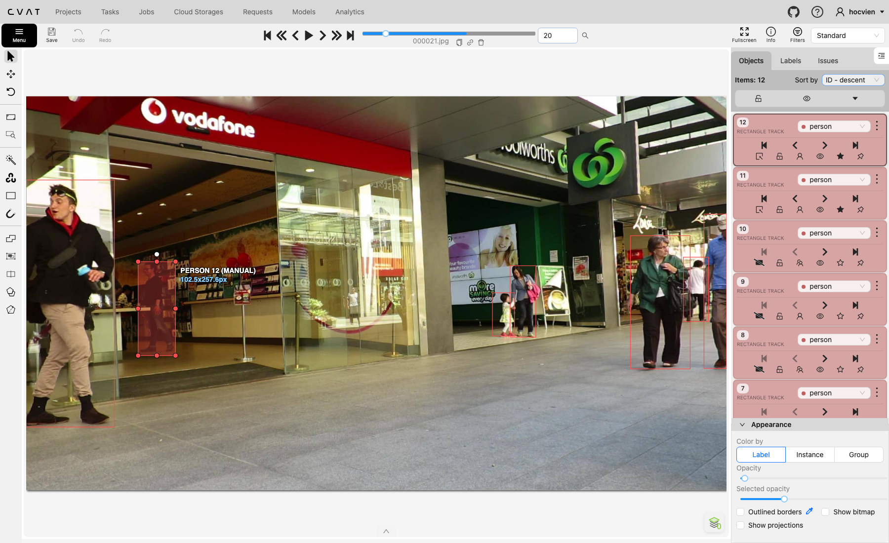
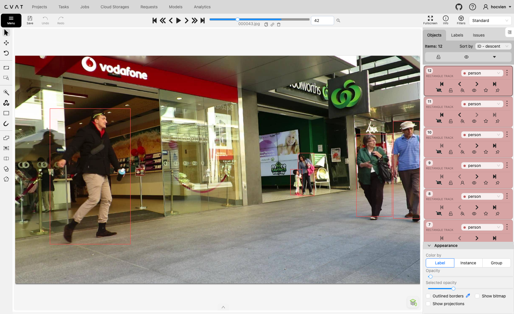
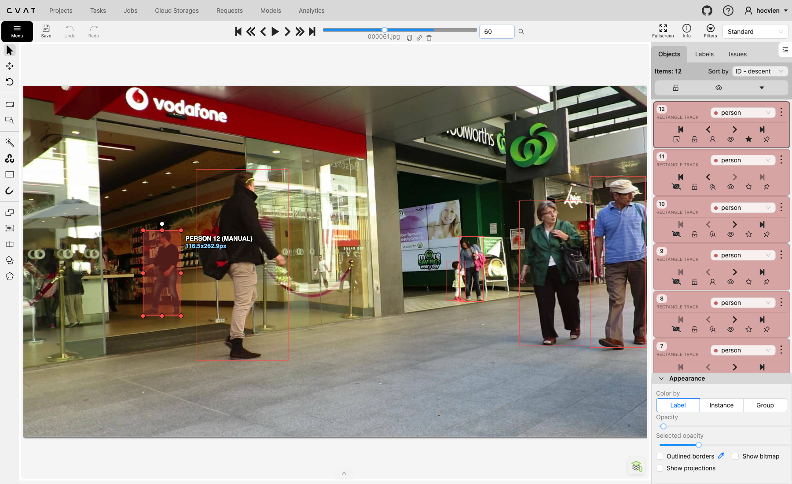

# Báo cáo cá nhân — Lê Quang Khải — 2A202603237

File báo cáo: `2A202603237_LeQuangKhai.md`.

Đoạn video: MOT17-09, 150 frame (frame 1–150), nguồn MOTChallenge, giấy phép CC BY-NC-SA 3.0.

## 0. Thông tin học viên

- Họ tên: Lê Quang Khải
- MSSV: 2A202603237
- Mã đề (A/B/C): B
- Email: lqkhai2512@gmail.com
- Link repository: https://github.com/kasdie/K5-L2-DAY05-LeQuangKhai-2A202603237-MOTTracking
- Giờ bắt đầu: 17:00 (giờ Việt Nam)
- Giờ kết thúc: 19:00 (giờ Việt Nam)
- Tổng thời gian theo ghi chép: 120 phút; chưa có số liệu thời gian riêng cho từng người.

## 1. Xem trước và đối chiếu đoạn video (CP0)

Bộ ghi chép hiện có không lưu đầy đủ bảng xem trước được lập trước khi vẽ. Bảng dưới đây được bổ sung sau khi gán bằng cách đối chiếu file CVAT đã xuất; các cột đầu/cuối là **frame có box trong track chính**, không được xem là thời điểm xuất hiện thật của người nếu nhãn chưa phủ đủ. Tôi không tự dựng lại các mốc rẽ/dừng chưa ghi nhận.

| Mã | Frame có box đầu tiên | Frame có box cuối cùng | Rẽ / dừng / đổi tốc độ | Frame occluded có box, theo nhãn | Ghi chú |
|---|---:|---:|---|---|---|
| P1 | 10 | 149 | Không có ghi chép riêng về mốc rẽ/dừng | 30–38, 46–54 | Người nam áo tối màu trong Vodafone; XML 11; outside keyframe: 6, 39, 40 |
| P2 | 0 | 149 | Không có ghi chép riêng về mốc rẽ/dừng | Không có trong nhãn | Người phụ nữ áo xanh phía trước; XML 0; outside keyframe: Không có |
| P3 | 20 | 149 | Không có ghi chép riêng về mốc rẽ/dừng | Không có trong nhãn | Người đàn ông áo xanh, đội mũ; XML 4; outside keyframe: Không có |
| P4 | 0 | 110 | Không có ghi chép riêng về mốc rẽ/dừng | 106–109 | Bé gái; XML 2; outside keyframe: 111 |
| P5 | 0 | 104 | Không có ghi chép riêng về mốc rẽ/dừng | 100–104 | Người phụ nữ đi cùng bé; XML 1; outside keyframe: 105 |

Riêng P1, nhãn tạm vắng ở frame 39–45 do outside, rồi hiện lại ở frame 46. Ảnh đầu đoạn cho thấy P1 đã có mặt trước mốc box đầu tiên 10; do đó bảng trên chỉ mô tả phạm vi nhãn đã lưu, không khẳng định không còn bỏ sót ở đầu đoạn. P4/P5 có các track bổ sung ở cuối đoạn trong bộ 12 track; khi đối chiếu danh tính cần xem cùng các track đó, thay vì suy ra người đã ra khỏi ảnh từ thời điểm track chính kết thúc.

## 2. Keyframe và thời gian (CP1, CP4)

Số keyframe lấy từ kết quả `src/check_submission.py`.

| Mã | Số keyframe | Keyframe ở frame | Số frame có mặt | Keyframe / 100 frame | Thời gian (phút) | Chỗ khó |
|---|---|---|---|---|---|---|
| P1 | 15 | 10, 20, 30, 33, 36, 46, 48, 55, 60, 70, 80, 100, 110, 120, 149 | 133 | 11.3 | Chưa ghi nhận | Sửa box bị lệch hoặc chưa bao đủ người; track XML 11 |
| P2 | 28 | 0, 10, 20, 30, 39, 40, 50, 61, 70, 80, 90, 98, 100, 103, 104, 110, 120, 121, 122, 124, 125, 130, 133, 139, 141, 142, 145, 149 | 150 | 18.7 | Chưa ghi nhận | Sửa box bị lệch hoặc chưa bao đủ người; track XML 0 |
| P3 | 14 | 20, 30, 39, 40, 50, 70, 80, 90, 100, 110, 120, 130, 139, 149 | 130 | 10.8 | Chưa ghi nhận | Sửa box bị lệch hoặc chưa bao đủ người; track XML 4 |
| P4 | 7 | 0, 10, 20, 40, 41, 106, 110 | 111 | 6.3 | Chưa ghi nhận | Sửa box bị lệch hoặc chưa bao đủ người; track XML 2 |
| P5 | 7 | 0, 10, 20, 40, 41, 87, 100 | 105 | 6.7 | Chưa ghi nhận | Sửa box bị lệch hoặc chưa bao đủ người; track XML 1 |
| **Tổng 5 track chính ở trên** | 71 | | 629 | 11,3 | Chưa ghi nhận | Chưa tính các track bổ sung |

Keyframe / 100 frame của toàn bộ 12 track trong bài = 104 ÷ 849 × 100 ≈ 12,2.

Các dòng P1–P5 ở trên thống kê theo track chính tương ứng trong XML; số liệu là từ nhãn đã lưu, không phải số đo ground truth. Thời gian thao tác từng người chưa được ghi nhận.

| Track XML bổ sung | Số keyframe | Số frame có mặt | KF / 100 frame |
|---|---:|---:|---:|
| 3 | 10 | 100 | 10.0 |
| 5 | 7 | 70 | 10.0 |
| 6 | 2 | 10 | 20.0 |
| 7 | 3 | 9 | 33.3 |
| 8 | 2 | 11 | 18.2 |
| 9 | 3 | 5 | 60.0 |
| 10 | 6 | 15 | 40.0 |

Khó khăn chung theo ghi chép: phải kiểm tra các frame trung gian và chỉnh lại box khi bị lệch hoặc chưa bao đủ toàn thân. Chưa có số liệu thời gian riêng cho từng người.

P2 có nhiều keyframe nhất trong năm track chính: 28 keyframe. Khi đối chiếu ảnh và nhãn, người phụ nữ này tiến lại gần camera nên box cần thay đổi cả vị trí lẫn kích thước. Chiều cao box trong file xuất tăng từ khoảng 340,6 pixel ở frame 0 lên 831,7 pixel ở frame 149. Các mốc 120, 121, 122, 124 và 125 cho thấy việc chỉnh được thực hiện dày hơn ở cuối đoạn để bám toàn thân. Tôi ưu tiên kiểm tra box giữa các mốc và bổ sung keyframe khi thấy lệch, thay vì chỉ giữ khoảng cách cố định 10 frame. Chuyển động nhanh nhưng thẳng đều không tự động đòi hỏi thêm keyframe nếu nội suy vẫn đúng.

## 3. Đoạn bị che (CP2)

Người bị che: `P1`

| Mốc | Frame |
|---|---:|
| Bắt đầu bị che một phần (bật `occluded`) | 30 |
| Mất hẳn (bật `outside`) | 39 |
| Hiện lại (tắt `outside`) | 46 |
| Thấy rõ trở lại (tắt `occluded`) | 55 |

- Thời gian khuất hẳn: 7 frame (39–45) = 7/30 ≈ 0,233 giây.
- Quyết định trong nhãn đã lưu: giữ cùng ID (track XML 11; MOT ID 4).
- Lý do theo ghi chép của tôi: đây là người nam trong cửa hàng đang có xu hướng đi ra phía cửa. Tôi quan sát người đó bị khuất khoảng frame 40 và thấy lại một phần cơ thể ở frame 46, nên đã Merge hai ID được gán cho cùng người. Theo file xuất, khoảng khuất hẳn là frame 39–45, chỉ 7 frame (khoảng 0,233 giây), ngắn hơn ngưỡng 60 frame của lớp.
- Trong ghi chép lúc làm, tôi gọi người này là **person 18**. Khi mở lại job để chụp minh chứng, CVAT hiển thị người đó là **PERSON 12** ở cả frame 20, 42 và 60. Đối chiếu dữ liệu cho thấy đây là server track 16, track XML 11 / MOT ID 4. Số ID giao diện có thể đổi khi nạp lại phiên; ba ảnh được chụp trong cùng phiên để kiểm tra tính liên tục.
- Khi đối chiếu lại ảnh, các dấu hiệu nhận diện của P1 là áo tối màu, quần bò và vị trí liên tục trong vùng cửa hàng Vodafone trước/sau khi người đi ngang che khuất. Người đó hiện lại gần vùng vừa bị che và tiếp tục di chuyển trong khu vực cửa hàng. Tôi kết hợp khoảng khuất ngắn, ngoại hình và tính liên tục của vị trí để giữ ID; không chỉ dựa vào giới tính. Không có số đo vận tốc để khẳng định tốc độ trước và sau hoàn toàn giống nhau.

Ba ảnh minh chứng dưới đây được chụp trực tiếp từ job CVAT đã lưu vào ngày 14/11/2026, cùng một phiên hiển thị PERSON 12. Thao tác chụp chỉ thay đổi frame và cách hiển thị Objects; không thay đổi box hoặc cờ nhãn.

Nguồn: MOT17, MOTChallenge (Milan et al., 2016).

**Frame 20 — trước khi che:** PERSON 12 có box; outside = false, occluded = false.


**Frame 42 — khuất hẳn:** thẻ PERSON 12 vẫn có trong Objects với outside = true; box của P1 không hiển thị trên ảnh.


**Frame 60 — sau khi hiện lại:** box mang cùng PERSON 12; outside = false, occluded = false.



## 4. Tự review ID (CP3)

Khi gán nhãn với bước nhảy 10 frame, tôi thấy box nội suy ở một số frame trung gian bị trượt hoặc chưa bao đủ toàn thân người, đặc biệt ở các đối tượng tôi ghi là person 1, 4 và 5. Tôi kiểm tra lại từng frame trong tổng số 150 frame và chỉnh các box bị lỗi. Tôi đã thực hiện cả hai lượt review: tua ngược theo từng người từ frame 149 về 0 và xem toàn cảnh theo bước nhảy 10 frame.

Các số person dưới đây giữ theo ghi chép ID trên CVAT của tôi; chưa xác nhận tương ứng với mã P1–P5 trong đề. Tôi không ghi lại chính xác các frame lỗi, nên chưa điền mốc cụ thể.

| Frame | Mã người theo ghi chép CVAT | Loại lỗi | Mô tả một câu | Cách phát hiện | Đã sửa? |
|---|---|---|---|---|---|
| Chưa ghi lại mốc cụ thể | person 1 | `drift` | Box ở một số frame trung gian bị lệch hoặc chưa bao đủ toàn thân khi người di chuyển. | Kiểm tra từng frame giữa các mốc cách 10 frame; chưa ghi riêng lượt phát hiện | Có |
| Chưa ghi lại mốc cụ thể | person 4 | `drift` | Box nội suy chưa bao đủ toàn thân, cần chỉnh lại tại các frame bị lỗi. | Kiểm tra từng frame giữa các mốc cách 10 frame; chưa ghi riêng lượt phát hiện | Có |
| Chưa ghi lại mốc cụ thể | person 5 | `drift` | Box nội suy bị lệch ở các frame trung gian, cần chỉnh lại vị trí và kích thước. | Kiểm tra từng frame giữa các mốc cách 10 frame; chưa ghi riêng lượt phát hiện | Có |

Lỗi tôi ghi nhận khi xem toàn cảnh cũng là box chưa bao đủ người trong các frame nội suy. Tôi chưa ghi nhận một lỗi riêng chỉ phát hiện được ở lượt toàn cảnh.

Ngoài lỗi drift, tôi đã chỉnh hai vấn đề của P1 qua việc đối chiếu nhãn và hướng dẫn thao tác:

| Khoảng frame / đối tượng | Loại lỗi | Hiện tượng và cách sửa | Nguồn ghi nhận |
|---|---|---|---|
| P1, hai đoạn trước/sau che quanh 39–60 | `fragmentation` | Cùng người được gán thành hai track; tôi Merge hai track để giữ một ID xuyên đoạn che. | Thao tác và trao đổi khi kiểm tra sau khi gán |
| P1, đoạn mất hẳn và hiện lại 39–46 | `flag` | Tôi chỉnh lại mốc outside: bật từ 39, tắt ở 46; giữ occluded lúc mới hiện lại và tắt từ 55. | Đối chiếu bản lưu và hướng dẫn thao tác |

Tổng hợp ghi chép: drift được ghi nhận ở ba nhóm person 1, 4 và 5 nhưng chưa đếm số frame lỗi; P1 có một trường hợp tách track và một đoạn cần chỉnh cờ. Các loại id_switch, lost, merge và false_track chưa có thống kê riêng, nên tôi không ghi 0 để khẳng định không có lỗi. “Merge” trong phần thao tác là công cụ nối track, khác với mã lỗi `merge` chỉ một box bao hai người. Các nhận xét có hỗ trợ đối chiếu được nêu rõ, không thay cho ghi chép tự phát hiện ban đầu.

### Đối chiếu lịch sử chỉnh sửa và bản lưu cuối

Bảng sau tổng hợp các sửa đổi có bằng chứng trong trao đổi và những lần đọc CVAT, phân biệt với các lỗi tự phát hiện nêu trên.

| Nội dung | Bản trước / vấn đề đã ghi nhận | Bản lưu cuối và số liệu đối chiếu |
|---|---|---|
| Giữ ID cho P1 | Hai server track 9 và 10 cho hai đoạn trước/sau che; tổng số track lúc đó là 13 | Hai đoạn đã được Merge thành server track 16; tổng số track hiện là 12 |
| Khoảng outside của P1 | Có lúc khoảng outside kéo tới trước frame 60; sau đó từng bị tắt cả ở 39/40 | Outside đúng đoạn 39–45: 7 frame; bật lại box từ 46. Ba ảnh 20/42/60 có cùng ID giao diện 12 |
| Keyframe P2 | Track chính của P2 có 15 keyframe ở lần kiểm tra ban đầu sau khi lưu toàn đoạn | Bản hiện tại có 28 keyframe, thêm 13 mốc: 39, 61, 98, 103, 104, 121, 122, 124, 125, 133, 141, 142, 145 |
| Keyframe của track chính P4 | Lần kiểm tra trước có 7 mốc, chưa có mốc 41 | Hiện có 8 mốc nếu tính cả outside; trong đó 7 keyframe có box. Thêm mốc 41 |
| Keyframe của track chính P5 | Lần kiểm tra trước có 6 mốc, chưa có 41 và 87 | Hiện có 8 mốc nếu tính cả outside; trong đó 7 keyframe có box. Thêm mốc 41 và 87 |

Việc thêm keyframe chứng minh nhãn đã được chỉnh, không tự chứng minh mọi box hoặc mọi ID đều đúng. Những thời điểm drift cụ thể không có ghi chép trước/sau vẫn được để rõ là chưa ghi lại; không gán một frame tùy ý cho lỗi đã sửa. Phép đối chiếu bản cuối xác nhận 12 track trong CVAT khớp tọa độ và cờ tại các keyframe với file CVAT XML đang nộp.

## 5. File xuất và kết quả tự kiểm (CP4)

| Kiểm tra | Kết quả |
|---|---|
| Tên file MOT 1.1 | `LeQuangKhai_mot.zip` |
| Tên file CVAT for video 1.1 | `LeQuangKhai_cvat_video.zip` |
| Số track ID khác nhau trong `gt/gt.txt` (mentor cho phép số người linh hoạt, theo xác nhận của học viên) | 12 |
| Frame `outside` không có dòng trong `gt.txt` (đúng / sai) | Đúng với P1: không có dòng tại frame CVAT 39–45 |
| Job đã completed trên CVAT máy cá nhân | Đã chuyển completed qua API |

Cảnh báo còn lại: XML track 9 có 3 keyframe tại 145, 146 và 148 trên 5 frame nhìn thấy (145–149), tương đương 60 keyframe/100 frame. Khi đối chiếu file xuất, track này có occluded trong cả 5 frame; chiều rộng box lần lượt khoảng 197,6, 215,3 và 229,4 pixel tại ba keyframe. Đoạn ngắn làm tỷ lệ chuẩn hóa cao dù số keyframe tuyệt đối chỉ là 3. Tôi giữ nguyên nhãn và công khai cảnh báo để được đánh giá chất lượng box; tỷ lệ này không tự chứng minh mọi keyframe đều cần thiết hoặc box đã đúng. Script không báo lỗi định dạng, nhưng kết quả đó không thay thế việc xem lại nhãn.

Kết quả `src/check_submission.py`:

```text
Số frame in theo CVAT (bắt đầu từ 0). Trong gt.txt, frame_id = frame CVAT + 1.

=== File MOT 1.1: LeQuangKhai_mot.zip ===
  Số track ID: 12   |   Tổng số box: 849
              Có 12 track ID; không áp giới hạn số track theo xác nhận của mentor.

  Track | Frame có mặt | Số frame | Đoạn vắng (outside)
      1 |   0–149      |      150 | -
      2 |   0–104      |      105 | -
      3 |   0–110      |      111 | -
      4 |  10–149      |      133 | 39–45
      5 |  15–29       |       15 | -
      6 |  20–119      |      100 | -
      7 |  20–149      |      130 | -
      8 |  80–149      |       70 | -
      9 | 130–139      |       10 | -
     10 | 138–146      |        9 | -
     11 | 139–149      |       11 | -
     12 | 145–149      |        5 | -


=== File CVAT for video 1.1: LeQuangKhai_cvat_video.zip ===

  Track | Nhãn   | Frame thấy | Keyframe | KF/100 frame | Frame occluded | Lần bật outside
      0 | person |        150 |       28 |         18.7 |              0 |               0
              Track 0: keyframe ở frame [0, 10, 20, 30, 39, 40, 50, 61, 70, 80, 90, 98, 100, 103, 104, 110, 120, 121, 122, 124, 125, 130, 133, 139, 141, 142, 145, 149]
      1 | person |        105 |        7 |          6.7 |              5 |               1
              Track 1: keyframe ở frame [0, 10, 20, 40, 41, 87, 100]
      2 | person |        111 |        7 |          6.3 |              4 |               1
              Track 2: keyframe ở frame [0, 10, 20, 40, 41, 106, 110]
      3 | person |        100 |       10 |         10.0 |             10 |               1
              Track 3: keyframe ở frame [20, 30, 40, 50, 60, 70, 80, 90, 100, 110]
      4 | person |        130 |       14 |         10.8 |              0 |               0
              Track 4: keyframe ở frame [20, 30, 39, 40, 50, 70, 80, 90, 100, 110, 120, 130, 139, 149]
      5 | person |         70 |        7 |         10.0 |              0 |               0
              Track 5: keyframe ở frame [80, 90, 100, 110, 120, 130, 149]
      6 | person |         10 |        2 |         20.0 |             10 |               1
              Track 6: keyframe ở frame [130, 132]
      7 | person |          9 |        3 |         33.3 |              7 |               1
              Track 7: keyframe ở frame [138, 140, 142]
      8 | person |         11 |        2 |         18.2 |              0 |               0
              Track 8: keyframe ở frame [139, 149]
      9 | person |          5 |        3 |         60.0 |              5 |               0
              Track 9: keyframe ở frame [145, 146, 148]
  [CẢNH BÁO]  Track 9: 60 keyframe / 100 frame > 50. Quá dày, dồn keyframe vào chỗ rẽ / dừng / bị che.
     10 | person |         15 |        6 |         40.0 |             11 |               1
              Track 10: keyframe ở frame [15, 18, 20, 24, 26, 28]
     11 | person |        133 |       15 |         11.3 |             18 |               1
              Track 11: keyframe ở frame [10, 20, 30, 33, 36, 46, 48, 55, 60, 70, 80, 100, 110, 120, 149]

  Tổng: 104 keyframe / 849 frame có mặt = 12.2 keyframe / 100 frame
  [OK]        Đọc được 12 track từ annotations.xml.

=== Tóm tắt ===
  Lỗi: 0   |   Cảnh báo: 1
  Không có lỗi định dạng. Mở CVAT xem lại từng [CẢNH BÁO]; cảnh báo đúng ý bạn thì ghi lý do vào báo cáo.
```

## 6. Ba câu kết

1. **Nếu được gán lại, bạn sẽ đặt keyframe khác ở đâu? Vì sao?**

   Nếu làm lại, tôi sẽ đặt thêm keyframe tại những đoạn người di chuyển nhanh mà box nội suy bị lệch, và quanh thời điểm người bắt đầu bị che hoặc xuất hiện trở lại sau vật/người đi ngang. Với P1, tôi chú ý các mốc quanh đoạn che 30–55, đặc biệt trước khi mất hẳn và khi hiện lại ở frame 46. Tôi sẽ xem các frame trung gian rồi chỉnh box ngay tại chỗ lệch, thay vì chỉ chỉnh ở những mốc cách nhau đúng 10 frame. Ở đoạn người đi thẳng đều và box vẫn bám đúng, tôi có thể giữ các mốc thưa hơn để giảm công sức mà vẫn bảo đảm chất lượng.

2. **Có chỗ nào bạn không chắc “cùng ID hay ID mới”? Bạn đã quyết định và ghi chú thế nào?**

   Tôi đã Merge hai ID được gán cho cùng một người nam trong cửa hàng, được tôi ghi là person 18 trên giao diện. Tôi quan sát người đó bị khuất khoảng frame 40 rồi thấy lại một phần cơ thể ở frame 46. Theo file xuất, khoảng mất hẳn là 39–45, tương đương 7 frame, ngắn hơn ngưỡng 60 frame của lớp. Khi đối chiếu lại, người đó có áo tối màu, quần bò, hiện lại trong cùng vùng cửa hàng và tiếp tục chuyển động phù hợp với vị trí trước đoạn che. Vì vậy tôi nối hai đoạn thành một track để giữ cùng ID, đồng thời chỉnh outside tại 39–45 và occluded khi mới hiện lại. Tôi ghi riêng ID trên giao diện với mã P1/ID xuất để tránh nhầm các hệ đánh số.

3. **Một lỗi ID trong job có thể làm xe tự lái dự đoán sai chuyển động như thế nào? Lỗi ảnh hưởng MOTA hay IDF1 nhiều hơn?**

   Trường hợp P1 bị tách thành hai ID trước và sau đoạn che có thể khiến một hệ thống xe tự lái hiểu người cũ đã biến mất và một người mới xuất hiện. Lịch sử vị trí của cùng người bị đứt, nên việc ước lượng hướng đi, tốc độ và dự đoán vị trí tiếp theo có thể kém ổn định. Tôi đã Merge hai track và giữ lại đoạn outside để biểu diễn cùng một người tạm thời không nhìn thấy. Về danh tính liên tục, lỗi này thể hiện rõ ở IDF1 vì một người bị chia thành nhiều ID. MOTA cũng có thể giảm nếu phép chấm ghi nhận đổi ID, bỏ sót hoặc box thừa; tôi không kết luận mức giảm cụ thể hoặc chỉ số nào giảm nhiều hơn về số học vì bài chưa tính MOTA/IDF1 với ground truth.

## Bonus

Bản bài nộp này không có sản phẩm bonus riêng và không đăng ký chấm bonus. Các người được gán thêm được giữ trong phần nhãn chính theo xác nhận của mentor do học viên cung cấp về số người linh hoạt.

## 7. Tài liệu tham khảo và công cụ AI đã dùng

- MOT17, MOTChallenge (Milan et al., 2016), giấy phép CC BY-NC-SA 3.0.
- Tài liệu lab: RULES.md, CHECKPOINTS.md, docs/GUIDELINE.md, docs/MOT_FORMAT.md và SUBMISSION.md trong repository VinUni-AI20k/K5-L2-MOTTracking.
- Codex: hỗ trợ môi trường và dữ liệu, tạo task trống, giải thích CVAT/keyframe/nội suy/MOTA/IDF1, đối chiếu nhãn đã lưu, xuất file, trích số liệu, chụp minh chứng CVAT và biên tập báo cáo. Phần diễn giải được bổ sung từ ghi chép của học viên và các gợi ý mà học viên đã đọc, đồng ý; bản báo cáo được hoàn thiện theo yêu cầu của học viên, đồng thời ghi rõ những thông tin chưa có bằng chứng. Nhãn và các chỉnh sửa nhãn do học viên thực hiện; không dùng model để sinh box/track ID cho bài nộp.
- Tool tự kiểm có tùy chọn `--allow-any-track-count` theo xác nhận của học viên rằng mentor cho phép số người linh hoạt. Các kiểm tra lỗi định dạng, box và cảnh báo khác vẫn được giữ.
